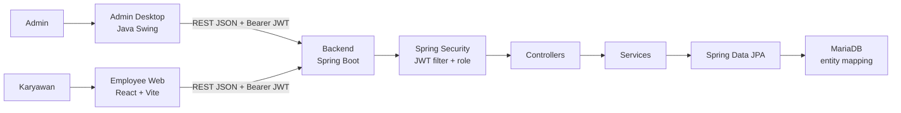

# Dokumentasi Diagram Sistem apkOffice

Dokumentasi ini menggambarkan implementasi yang ditemukan pada source code. Set sequence Admin Desktop diperbarui pada 26 November 2026; diagram lain mencerminkan audit sebelumnya. Diagram dibuat dari controller, service, entity, repository, client API, route UI, dan berkas SQL migrasi. Nilai konfigurasi, credential, dan database aktif tidak dibaca.

## Ringkasan arsitektur

Backend adalah pusat autentikasi, otorisasi, aturan proses, dan akses data. Kedua client menggunakan API backend; source code Admin Desktop tidak membuka koneksi database langsung. Employee Web menyimpan token dan ringkasan user pada `sessionStorage`; Admin Desktop menaruh identitas dan token pada `AuthSession` di memori.

## Daftar diagram

| Diagram | Tujuan |
|---|---|
| [System workflow](workflow/system-workflow.md) | Alur lintas aplikasi, autentikasi, pengolahan dan penyimpanan data. |
| [Use case](usecase/usecase-diagram.md) | Fitur yang dapat dilakukan Admin dan Employee menurut endpoint serta UI aktual. |
| [Overall class](class/overall-class-diagram.md) | Lapisan backend dan hubungan entity utama. |
| [Task and auth class](class/module-class-diagram.md) | Detail class proses tugas, assignment, absensi, serta autentikasi. |
| [Login activity](activity/login-activity.md) | Cabang login berhasil/gagal dan pemeriksaan role di client. |
| [Main workflows activity](activity/main-workflows.md) | Proses absensi, siklus status tugas, data master, dan laporan. |
| [Object example](object/object-diagram.md) | Contoh instance dummy yang konsisten dengan entity. |
| [Admin account sequence](sequence/authentication-sequence.md) | Login Admin, ubah password, dan logout lokal. |
| [Master User sequence](sequence/master-user-sequence.md) | Daftar, tambah, ubah, dan hapus employee. |
| [Master referensi sequence](sequence/master-reference-sequence.md) | CRUD jabatan dan jenis tugas. |
| [Task management sequence](sequence/task-assignment-sequence.md) | Baca, tambah bulk, ubah, dan hapus tugas. |
| [Task verification sequence](sequence/task-verification-sequence.md) | Approve/reject, alasan penolakan, dan penjadwalan ulang manual. |
| [Admin attendance sequence](sequence/admin-attendance-sequence.md) | Daftar absensi hari ini di Admin Desktop. |
| [Admin dashboard sequence](sequence/admin-dashboard-sequence.md) | Pengambilan dan agregasi ringkasan dashboard. |
| [Admin reports sequence](sequence/report-sequence.md) | Daftar tugas, rekap absensi, rekap tugas, dan rekap nominal. |
| [Employee attendance sequence](sequence/attendance-sequence.md) | Check-in, check-out, dan baca riwayat di Employee Web. |
| [Employee task sequence](sequence/employee-task-sequence.md) | Baca, mulai, dan kirim tugas dari Employee Web. |

Delapan sequence Admin di atas merupakan set yang diprioritaskan untuk laporan/FDD Admin Desktop. Dua sequence Employee Web dipertahankan sebagai dokumentasi pendukung sistem.

## Temuan implementasi yang memengaruhi interpretasi

- Role yang ada hanya `ADMIN` dan `EMPLOYEE`. Pembuatan/pengelolaan user melalui service membatasi role menjadi `EMPLOYEE`; Admin tetap dikelola di luar modul karyawan.
- Status proses berada di entity `Tugas`, bukan per anggota tim. `startTugas`, `submitTugas`, dan `verifyTugas` mengubah satu status bersama. Nilai nominal berada di `PenugasanKaryawan` per karyawan.
- Check-out memakai tugas yang ditugaskan kepada karyawan untuk tanggal attendance hari ini. Hanya `PENDING` dan `IN_PROGRESS` yang memblokir; `SUBMITTED`, `APPROVED`, `REJECTED`, atau tidak ada tugas hari ini mengizinkan check-out.
- Employee Web memiliki route `/preview-dashboard`, `/preview-list-tugas`, dan `/preview-riwayatAbsensi` di luar `ProtectedRoute`. Route reguler berada di dalam `ProtectedRoute`, yang hanya mengecek keberadaan token di browser; akses data tetap dibatasi backend.
- Employee Web tidak menghapus token atau mengarahkan ulang saat API request menjawab 401; route guard hanya melihat token masih ada. Sesi expired dapat membuat UI tetap berada di route protected sementara request terus gagal.
- `DELETE /api/attendance/my` tercantum dalam matcher keamanan, tetapi tidak ditemukan handler controller untuk route itu.
- Endpoint pembuatan tugas memeriksa role `EMPLOYEE`, tetapi tidak memeriksa status `ACTIVE` pada backend; form Admin sendiri menyaring karyawan aktif. Pada update, service mengharuskan assignee baru aktif.
- `FileStorageService` dan pemetaan statis `/uploads/**` tersedia, tetapi tidak ditemukan controller atau pemanggil `saveFile`; tidak dimodelkan sebagai alur upload aktif.
- Test yang ditemukan hanya `BackendApplicationTests.contextLoads`; tidak ditemukan suite test source untuk client pada file yang diaudit. Test tidak dijalankan.
- Migrasi SQL berisi langkah bertahap dan instruksi eksekusi manual. Source code tidak mengungkap migrasi mana yang sudah diterapkan pada database yang berjalan. Database tidak diakses selama audit.
- `docs/api.md` masih memiliki request user berbentuk field `jabatan` teks, sedangkan DTO backend saat ini menerima `jabatanId` numerik. Contoh dokumentasi lama tersebut tidak cocok dengan kontrak request terkini.

## Peta API yang menjadi dasar use case

| Endpoint | Akses dan pemakaian yang ditemukan |
|---|---|
| `POST /api/auth/login` | Publik; dipakai Admin Desktop dan Employee Web. |
| `GET /health` | Publik; health response sederhana. |
| `/uploads/**` | Diizinkan publik sebagai static resource; tidak ada endpoint upload yang ditemukan. |
| `GET /api/users`, `POST /api/users`, `PUT /api/users/{id}`, `DELETE /api/users/{id}` | Admin; service hanya mengizinkan role EMPLOYEE untuk create/update pada modul user. |
| `PUT /api/users/change-password` | Semua user terautentikasi; service mencari user dari username token dan memeriksa password lama. |
| `GET /api/jabatan[?aktif=true]`, `GET /api/jabatan/{id}`, `POST`, `PUT /{id}`, `PUT /{id}/status`, `DELETE /{id}` | Admin; UI memakai daftar aktif untuk pilihan jabatan karyawan. |
| `GET /api/jenis-tugas`, `GET /{id}`, `POST`, `PUT /{id}`, `DELETE /{id}` | Admin; jenis yang masih dipakai tugas tidak dapat dihapus. |
| `GET /api/attendance` | Admin; dipakai dashboard dan report absensi. |
| `GET /api/attendance/my` | Terautentikasi; attendance service membatasi hasil pada user dari username token. |
| `POST /api/attendance/check-in`, `POST /api/attendance/check-out` | Controller membatasi ke EMPLOYEE; aturan tanggal dan check-out di `AttendanceService`. |
| `GET /api/tugas` | Terautentikasi; Admin mendapat semua tugas, Employee hanya tugas yang di-assign dan perlu record attendance hari ini. |
| `POST /api/tugas`, `POST /api/tugas/bulk` | Admin; membuat satu task dan assignment untuk satu atau beberapa user. |
| `PUT /api/tugas/{id}` | Admin; task hanya dapat diedit saat `PENDING` atau `REJECTED`. |
| `DELETE /api/tugas/{id}` | Admin; hanya `PENDING` dapat dihapus. Response controller adalah 204. |
| `PUT /api/tugas/{id}/start`, `PUT /api/tugas/{id}/submit` | Employee assignee dengan attendance hari ini aktif dan belum check-out. |
| `PUT /api/tugas/{id}/verify` | Admin; hanya task `SUBMITTED` dapat diproses. |

Semua endpoint yang tidak dikecualikan oleh `SecurityConfig` memerlukan autentikasi. Matcher `DELETE /api/attendance/my` tercatat untuk EMPLOYEE, tetapi controller tidak memiliki mapping DELETE tersebut. CORS browser diizinkan untuk origin yang dicantumkan secara eksplisit pada `CorsConfig`; Admin Desktop memakai Java HTTP client dan tidak bergantung pada CORS browser.

## Skema data yang dapat diturunkan dari source

- `user`: generated `Long id`; username/email unik; password disimpan hash; role dan status enum-string; optional FK `jabatan_id`.
- `jabatan`: generated `Long id`, nama, nama normalized unik, status, timestamp.
- `jenis_tugas`: primary key string `id`, nama unik.
- `attendance`: generated `Long id`, FK user, tanggal, `jam_masuk`, optional `jam_keluar`, status string, optional foto.
- `tugas`: primary key string max 32, optional jenis tugas, nama pelanggan/lokasi/link/deskripsi, status string, tanggal, timestamp.
- `penugasan_karyawan`: composite key (`tugas_id`, `karyawan_id`), FK task dan user, optional nominal decimal per anggota.
- `tugas_id_sequence`: tidak memiliki entity/repository; dibuat dan dibaca oleh query native `TugasIdGenerator`, counter disimpan per tahun.

`database/` hanya berisi `.gitkeep`; migrasi berada di backend. Entity/migrasi tidak cukup untuk memastikan tipe/collation, index, constraint, atau versi migrasi pada database aktif. `backend/pom.xml` tidak mencantumkan Flyway; beberapa migration berkomentar untuk dijalankan manual. File konfigurasi runtime tidak dibaca dalam audit ini.

## Integrasi client

- Employee Web membaca nama base URL dari `VITE_API_URL` via `import.meta.env`, mengirim JWT pada header `Authorization`, dan menyimpan token/user di `sessionStorage`. `ProtectedRoute` hanya memeriksa token yang ada; otorisasi role dan data tetap harus datang dari backend.
- Admin Desktop membaca `API_BASE_URL` dari `config.properties` relatif terhadap working directory. `ApiClient` memakai bearer JWT dari `AuthSession`, timeout koneksi 8 detik dan request 15 detik.
- Employee Web mengambil attendance dan tugas lewat `services/api.js`/`attendanceService.js`; frontend tidak mengakses MariaDB langsung. `attendanceStorage.js` ditemukan tetapi tidak dipakai oleh alur hook absensi saat ini.
- Admin Desktop memakai `AuthApiService`, `UserApiService`, `AttendanceApiService`, `TaskApiService`, `JabatanApiService`, dan `JenisTugasApiService`; tidak ada koneksi SQL di modul tersebut.

## Batas audit dan validasi

Model data di diagram diturunkan dari JPA entity dan migrasi yang tersedia. Diagram tidak menyatakan kondisi aktual database. Endpoint memakai path dan kontrol yang ditemukan di controller/security configuration. Tidak ada request, query database, build, atau test aplikasi yang dijalankan untuk audit dokumentasi ini. Tidak ada Mermaid CLI/parser terpasang di workspace; syntax blocks, pasangan `alt/else/end`, links class, label dan referensi diagram telah diperiksa secara statis. Render visual di Mermaid renderer belum dapat diverifikasi dari lingkungan ini.

## Sumber source utama

- Backend: `backend/src/main/java/com/apoffice/backend/{config,controller,service,repository,entity,dto}`.
- Migrasi: `backend/src/main/resources/db/migration/`.
- Employee Web: `employee-web/src/{App.jsx,services,hooks,pages,components}`.
- Admin Desktop: `admin-desktop/src/main/java/com/mycompany/admin/desktop/{AdminDesktop.java,api,auth,service,screens}`.
