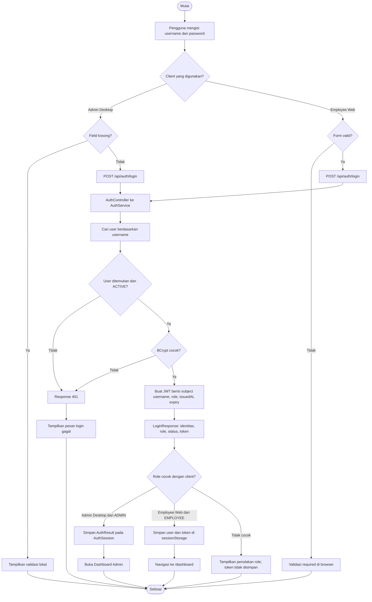

# Login Activity Diagram

**Tujuan:** Menjelaskan pemeriksaan kredensial di backend dan pemeriksaan role yang dilakukan masing-masing client setelah menerima response.

**Interpretasi:** Password diverifikasi backend dengan `PasswordEncoder` BCrypt dan akun nonaktif ditolak sebelum token diterbitkan. Pemeriksaan role Admin/Employee juga dilakukan di UI masing-masing setelah response login; endpoint terlindungi tetap memiliki kontrol backend sendiri. Login Employee menyimpan token dalam `sessionStorage`, sedangkan Admin Desktop menyimpan token pada session singleton di memori.
