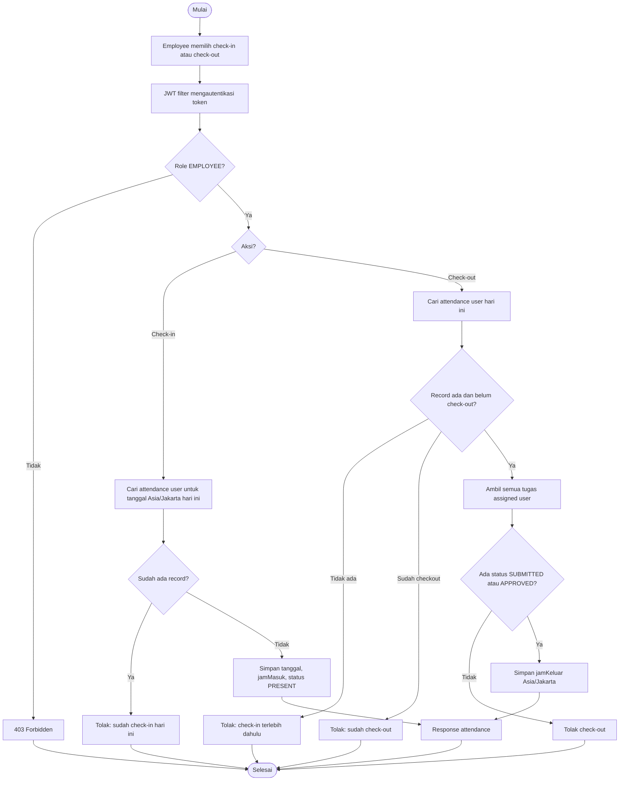
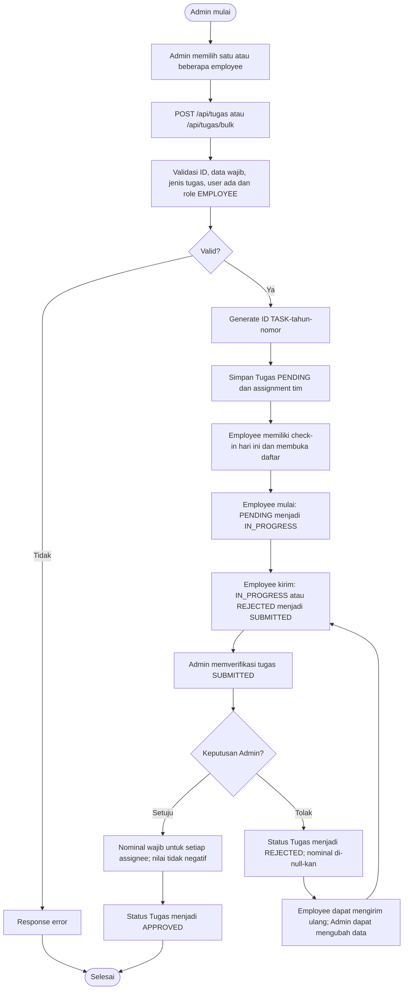
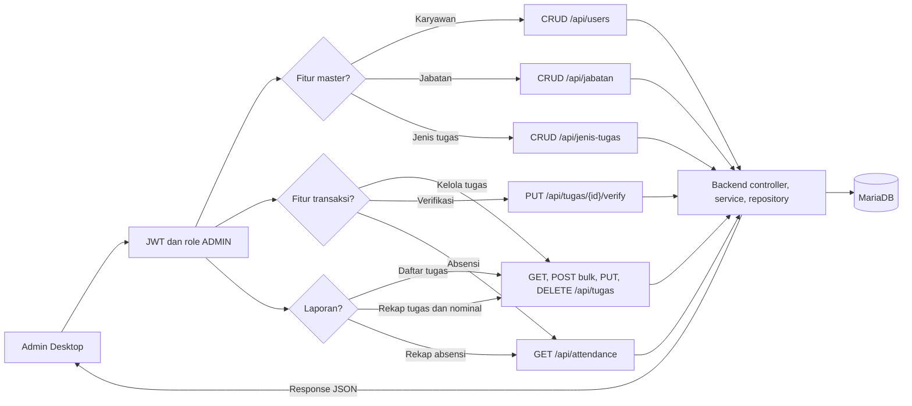

# Main Workflows Activity Diagrams

## Absensi karyawan

**Tujuan:** Memperlihatkan check-in, check-out, dan prasyarat check-out yang diterapkan service.

**Interpretasi:** `jamKeluar` tidak diisi saat check-in. Pemeriksaan tugas saat check-out memakai semua tugas hasil `findAssignedTo(user)` tanpa batas tanggal; status accepted adalah `SUBMITTED` atau `APPROVED`.

## Siklus tugas tim

**Tujuan:** Menunjukkan pembuatan/penugasan, aksi Employee, dan verifikasi Admin.

**Interpretasi:** Satu `Tugas` mempunyai satu status bersama untuk semua anggota; nominal disimpan satu nilai per `PenugasanKaryawan`. Perubahan status oleh satu anggota memengaruhi object tugas yang sama untuk anggota tim lain.

## Data master dan laporan Admin

**Tujuan:** Merangkum layar Admin yang menggunakan endpoint CRUD dan laporan aktual.

**Interpretasi:** Empat report Admin tidak memakai endpoint report terpisah. Report tugas dan rekap produktivitas/nominal mengambil tugas dari API; rekap absensi mengambil data absensi. Ringkasan dihitung dan dirender di desktop.
