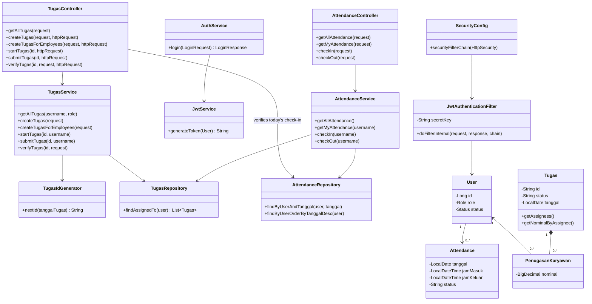

# Class Diagram Modul Tugas, Absensi, dan Autentikasi

**Tujuan:** Memperinci dependency dan domain relasi yang menjalankan alur utama. Class diagram tidak menyamakan `status` tugas dengan status per anggota; status hanya dimiliki `Tugas`.

### Fakta model yang relevan

- `Attendance.jamKeluar` dapat null sebelum check-out; hanya satu record tanggal/user yang dicari oleh service untuk check-in dan check-out.
- Anggota task disimpan melalui composite key `(tugas_id, karyawan_id)` pada `PenugasanKaryawan`; nominal null atau bernilai per assignment.
- `Tugas.status` mencakup nilai string yang digunakan service: `PENDING`, `IN_PROGRESS`, `SUBMITTED`, `APPROVED`, `REJECTED`.
- `TugasIdGenerator` menggunakan query native ke `tugas_id_sequence`, mengunci sequence per tahun, lalu membentuk `TASK-<tahun>-<nomor 4 digit minimum>`.
- JWT filter membuat authority `ROLE_ADMIN`/`ROLE_EMPLOYEE` setelah memeriksa signature/expiry, role claim, dan status/role akun melalui `UserRepository`.

**Interpretasi:** Relationship pada class diagram berasal dari `@ManyToOne`, `@OneToMany`, dan composite `@EmbeddedId`. Repository untuk `PenugasanKaryawan` tidak dideklarasikan tersendiri; persist dilakukan melalui collection pada `Tugas`.
