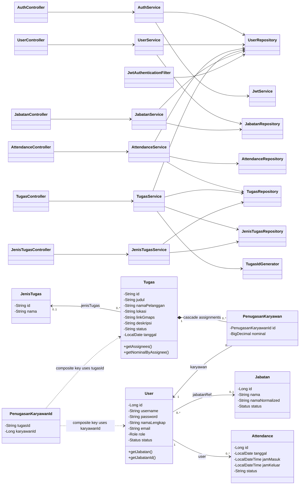

# Overall Class Diagram

**Tujuan:** Menunjukkan lapisan backend dan domain persistence utama. DTO generik dan form Swing tidak ditampilkan agar hubungan arsitektur tetap terbaca.

**Interpretasi relasi:** `Tugas` mengelola collection `PenugasanKaryawan` dengan cascade dan orphan removal. Ini adalah relasi tim many-to-many yang direalisasikan lewat entity penghubung karena tabel tersebut juga menyimpan `nominal` per karyawan. `User` memiliki opsional `Jabatan`, dan satu user dapat memiliki banyak record attendance.

**Sumber:** `backend/src/main/java/com/apoffice/backend/{controller,service,repository,entity}`.
