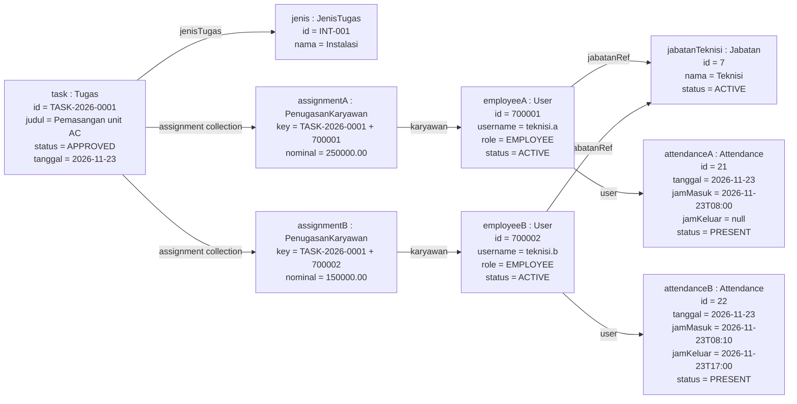

# Object Diagram — Contoh Tim Tugas

**Tujuan:** Memberikan snapshot object dummy untuk relasi user, jabatan, attendance, tugas, dan nominal assignment. Nama/email serta ID berikut hanya contoh dan bukan data database.

**Interpretasi:** Satu task tim direpresentasikan oleh satu `Tugas` dan dua row `PenugasanKaryawan`. `nominal` berbeda per anggota; status `APPROVED` hanya berada pada task. Attendance adalah object masing-masing user dan field `jamKeluar` dapat null sebelum checkout.
