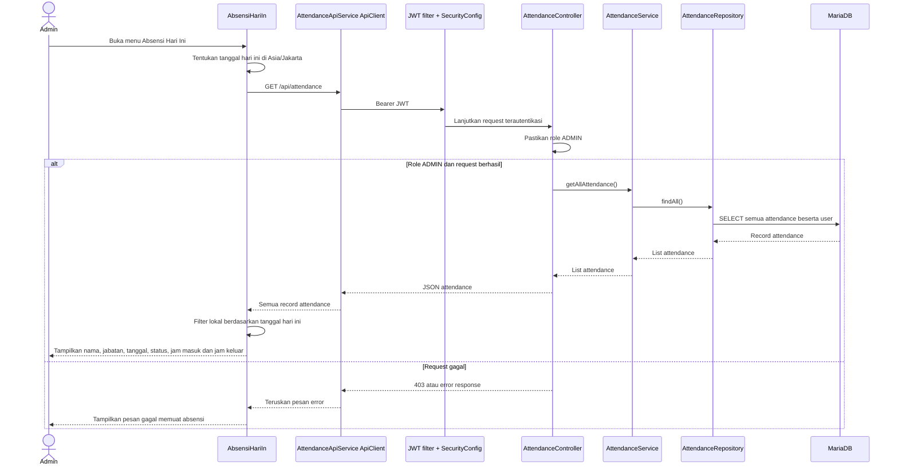

# Admin Attendance Today Sequence

**Tujuan:** Menjelaskan pemuatan daftar absensi hari ini pada Admin Desktop.

**Interpretasi:** Endpoint mengembalikan semua data attendance untuk Admin. `AbsensiHariIn` menyaring record tanggal saat ini di desktop; halaman ini hanya membaca dan menampilkan absensi, tidak mengubah record.
