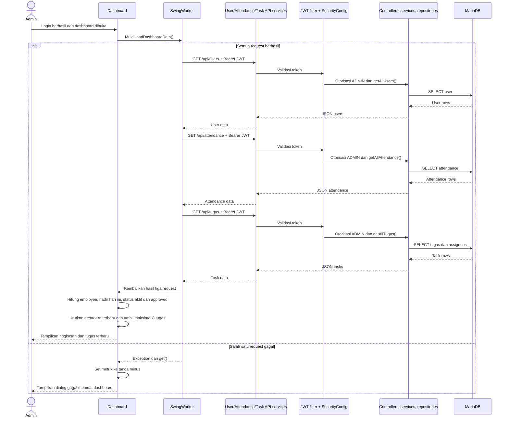

# Admin Dashboard Sequence

**Tujuan:** Menjelaskan pengambilan dan agregasi data ringkasan dashboard Admin Desktop.

**Interpretasi:** Dashboard memanggil endpoint user, attendance, lalu tugas secara berurutan di `SwingWorker`. Hitungan employee memakai role `EMPLOYEE`; hadir hari ini memakai tanggal WIB dan status `PRESENT`; tugas aktif mencakup `PENDING`, `IN_PROGRESS`, `SUBMITTED`, `REJECTED`, sedangkan `APPROVED` dihitung terpisah. Jika satu request gagal, rangkaian fetch berhenti dan dashboard menampilkan dialog error.
