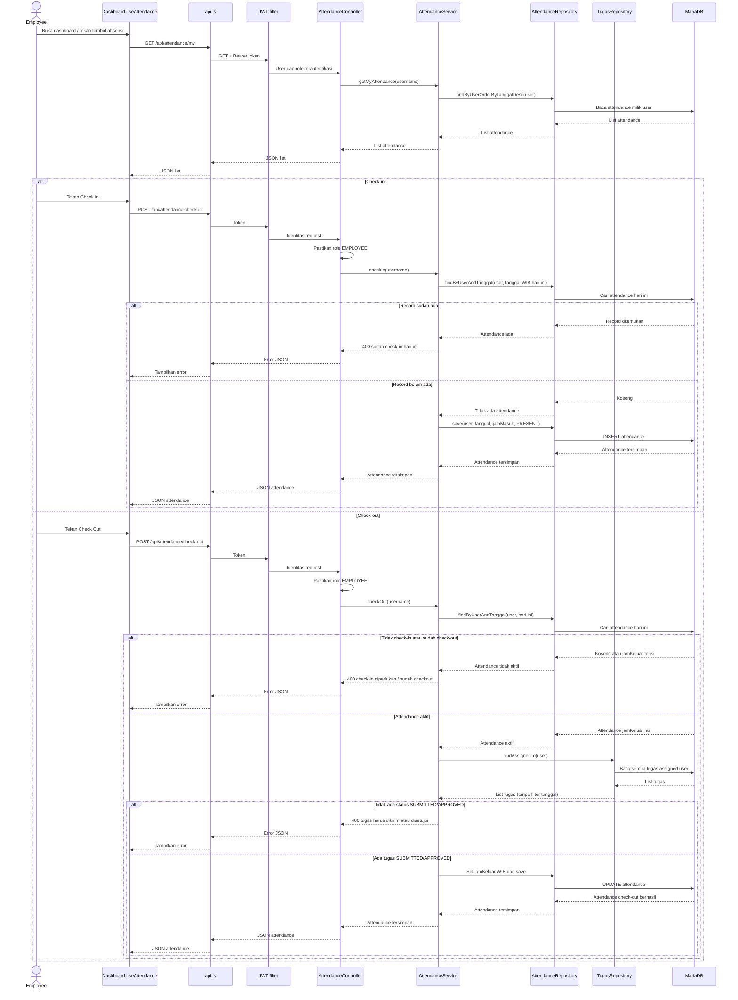

# Attendance Sequence

**Tujuan:** Menelusuri request absensi Employee Web hingga repository dan database, termasuk aturan check-out.

**Interpretasi:** UI membaca riwayat untuk menemukan record tanggal hari ini. Guard frontend memudahkan UX, sementara role dan aturan utama ditegakkan controller/service. Backend tidak membuat checkout otomatis lintas hari pada alur yang ditelusuri ini.
