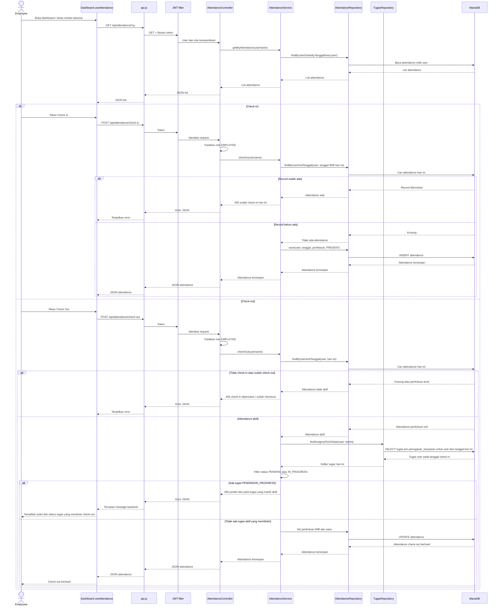

# Attendance Sequence

**Tujuan:** Menelusuri request absensi Employee Web hingga repository dan database, termasuk aturan check-out.

**Interpretasi:** Tugas dihitung per karyawan dan hanya jika `tugas.tanggal` sama dengan tanggal check-in hari ini. Status `PENDING` dan `IN_PROGRESS` menahan check-out; `SUBMITTED`, `APPROVED`, dan `REJECTED` tidak. Jika tidak ada tugas pada tanggal itu, check-out tetap boleh. Pesan penolakan memuat jumlah, judul, dan status tugas penghambat. Tanggal tugas adalah tanggal rencana, bukan tanggal pembuatan atau deadline; status tugas bersama berlaku bagi seluruh assignee.
