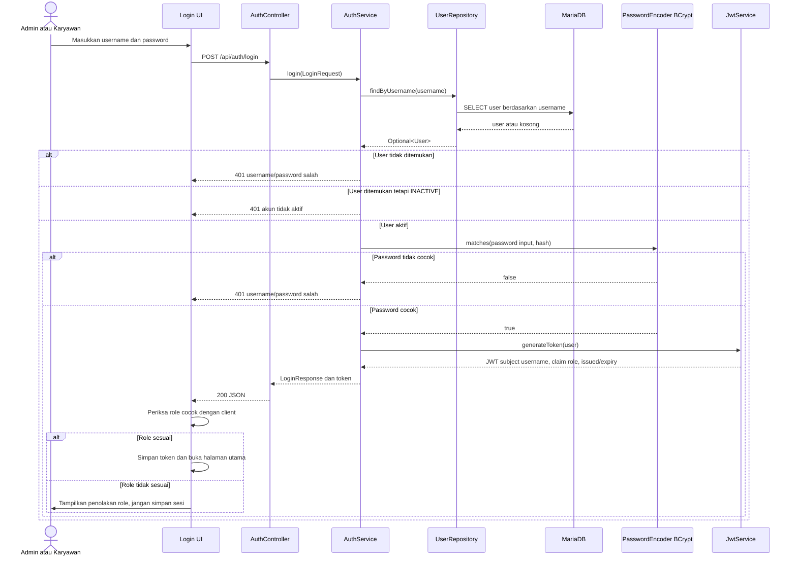
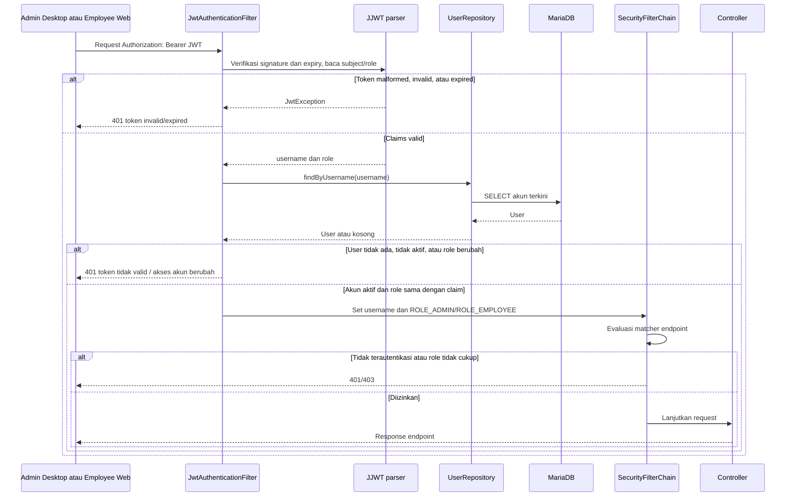

# Authentication Sequence

**Tujuan:** Memerinci login dari dua client dan autentikasi token pada request protected.

## Login

## Request terautentikasi

**Interpretasi:** Session backend stateless. Filter membaca ulang akun pada database tiap request protected, sehingga akun nonaktif atau perubahan role membatalkan token lama. Login berhasil sendiri tidak menjamin role cocok untuk aplikasi; Admin Desktop menolak role selain ADMIN dan Employee Web menolak role selain EMPLOYEE.
