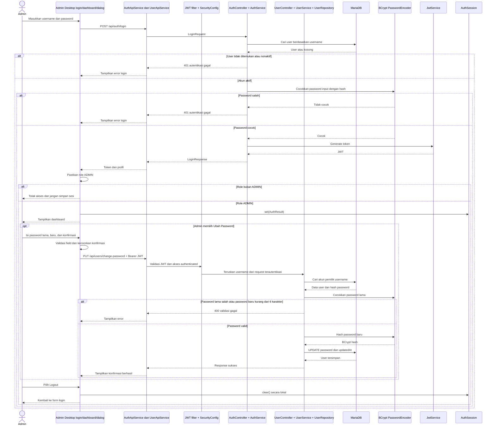

# Admin Account Sequence

**Tujuan:** Merangkum login Admin Desktop, perubahan password, dan logout lokal dalam satu siklus sesi.

**Interpretasi:** Login memeriksa kredensial dan status akun di backend; sesi Admin Desktop hanya dibuat untuk role `ADMIN`. Perubahan password memakai endpoint terlindungi, memeriksa password lama, dan menyimpan hash baru. Logout hanya membersihkan `AuthSession` di desktop dan tidak menghubungi backend.
