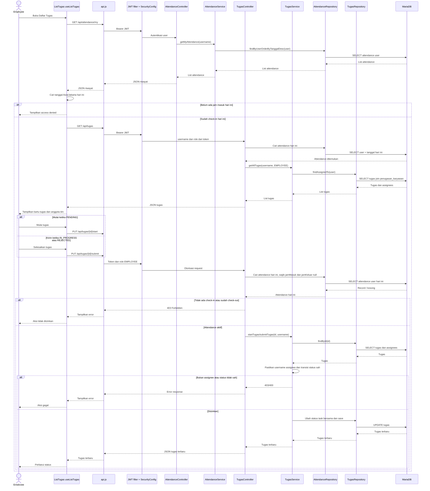

# Employee Task Sequence

**Tujuan:** Menelusuri pemuatan daftar tugas serta aksi mulai/kirim dari Employee Web.

**Interpretasi:** Sebelum memuat tugas, UI membaca attendance pribadi lalu memastikan ada check-in hari ini. Controller mengulang pemeriksaan attendance untuk daftar tugas, dan memeriksa attendance aktif (belum checkout) untuk aksi start/submit. Perubahan status pada entity `Tugas` berlaku pada semua assignee.
