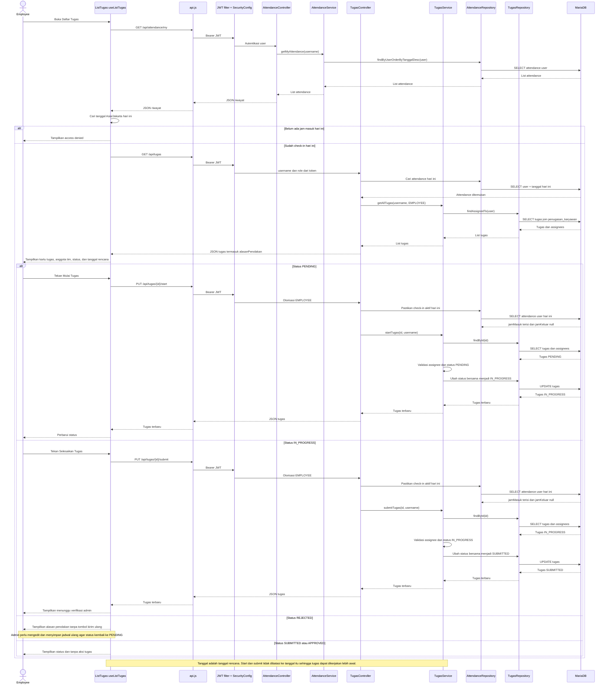

# Employee Task Sequence

**Tujuan:** Menelusuri pemuatan daftar tugas serta aksi mulai/kirim dari Employee Web.

**Interpretasi:** Sebelum memuat tugas, UI membaca attendance pribadi lalu memastikan ada check-in hari ini. Controller juga mensyaratkan record check-in hari ini saat `GET /api/tugas`, tetapi tetap mengizinkan karyawan yang sudah check-out melihat daftar. Aksi start/submit memerlukan attendance aktif dan karyawan harus menjadi assignee. UI menampilkan tombol mulai pada `PENDING` dan tombol kirim pada `IN_PROGRESS`; pada `REJECTED`, UI menampilkan alasan penolakan tanpa tombol kirim ulang. Admin mengubah tugas yang ditolak melalui alur penjadwalan ulang. Tanggal rencana tidak membatasi karyawan untuk memulai lebih awal. Status pada entity `Tugas` berlaku bagi semua assignee. Implementasi service masih menerima `REJECTED` pada endpoint submit jika dipanggil langsung, meskipun Employee Web tidak menampilkan tombol untuk status itu.
