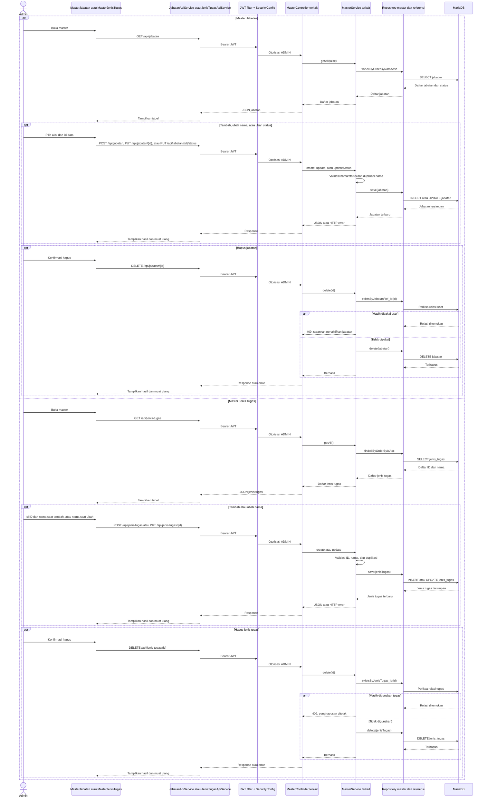

# Master Jabatan dan Jenis Tugas Sequence

**Tujuan:** Merangkum CRUD master referensi yang dikelola Admin Desktop.

**Interpretasi:** Jabatan mendukung tambah, ubah nama, ubah status, dan hapus jika belum direferensikan user. Jenis tugas mendukung tambah, ubah nama, dan hapus jika belum direferensikan tugas; tidak ada endpoint status jenis tugas.
