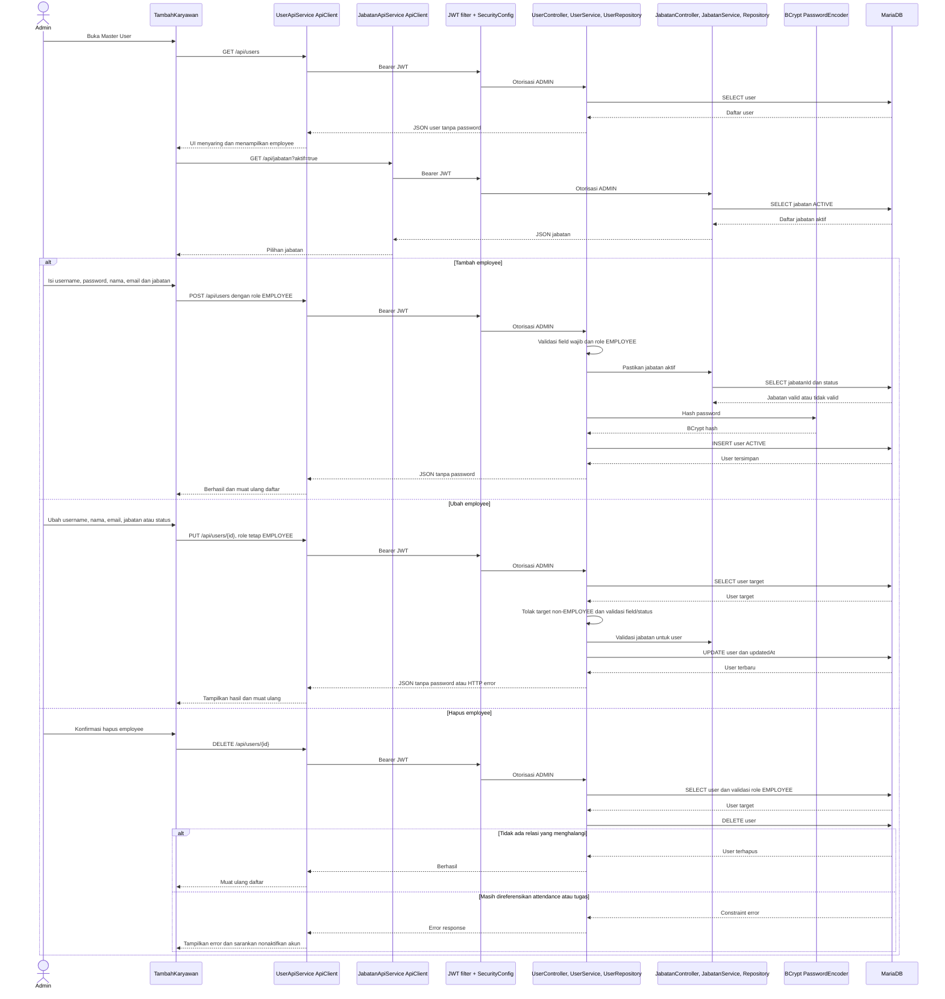

# Master User Sequence

**Tujuan:** Menjelaskan daftar dan CRUD akun karyawan melalui Admin Desktop.

**Interpretasi:** Modul hanya mengelola role `EMPLOYEE`; akun `ADMIN` tidak dapat dibuat, diubah, atau dihapus melalui Master User. Penghapusan employee bisa ditolak karena relasi data. Password hanya dikirim saat pembuatan dan di-hash di backend.
