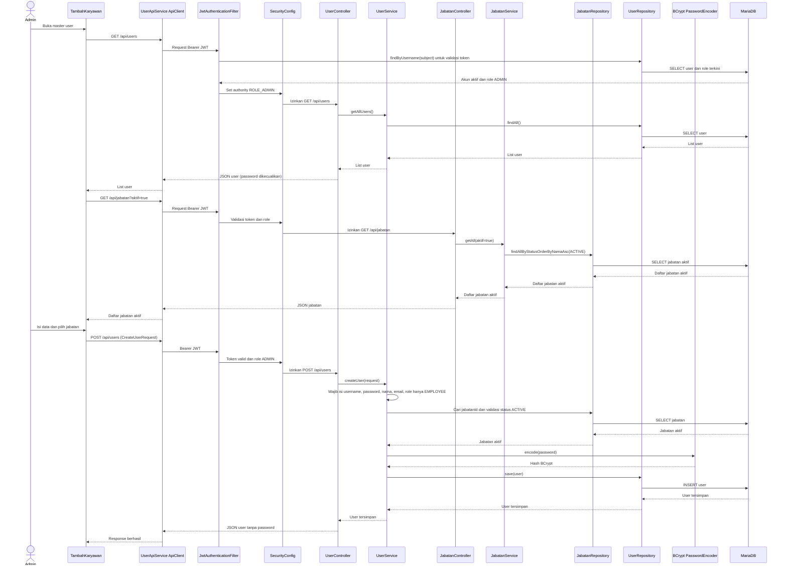
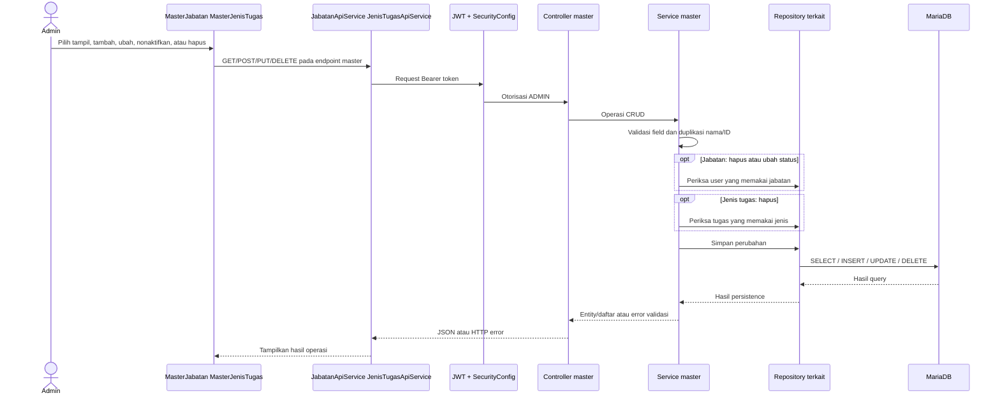

# Master User dan Master Data Sequence

**Tujuan:** Menjelaskan pembuatan karyawan dari Admin Desktop serta bentuk umum CRUD master jabatan/jenis tugas.

## Buat karyawan

## Pengelolaan master jabatan dan jenis tugas

**Interpretasi:** CRUD master jabatan dan jenis tugas hanya tersedia untuk ADMIN. Jabatan menyediakan perubahan status; penghapusan ditolak bila sedang dipakai user. Jenis tugas dapat dihapus hanya bila belum dipakai tugas. Pengelolaan user menolak role selain EMPLOYEE; pembuatan memerlukan jabatan aktif.
