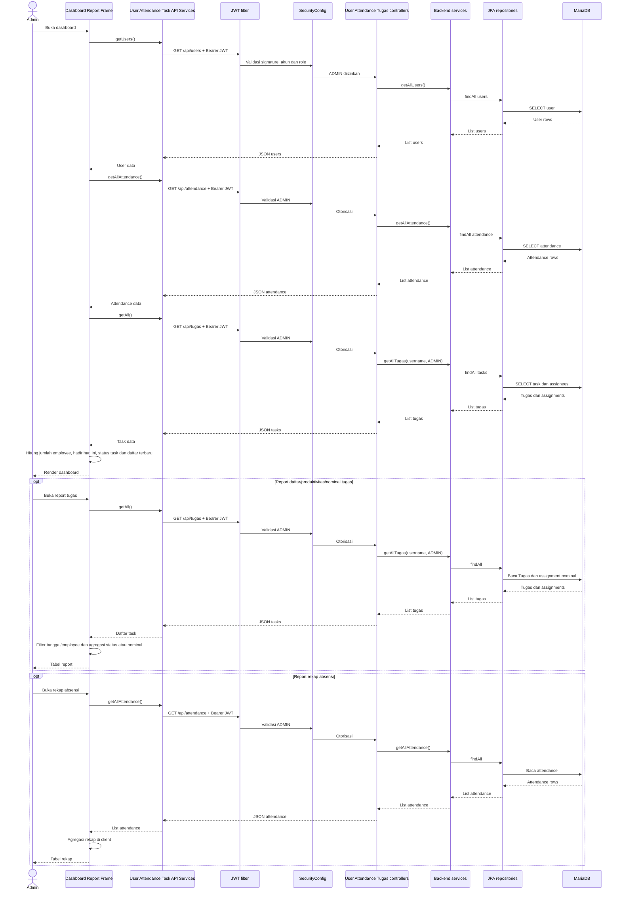

# Report Sequence

**Tujuan:** Menunjukkan pengambilan data laporan Admin. Report dihitung di Admin Desktop; tidak ada endpoint `/api/reports` pada source.

**Interpretasi:** Pada dashboard, pemanggilan user, attendance, dan tugas dijalankan berurutan di `SwingWorker`. Report produktivitas/nominal memfilter data task yang diambil dari endpoint umum dan menghitung total di desktop. Rekap absensi menggunakan endpoint daftar seluruh attendance yang hanya mengizinkan Admin.
