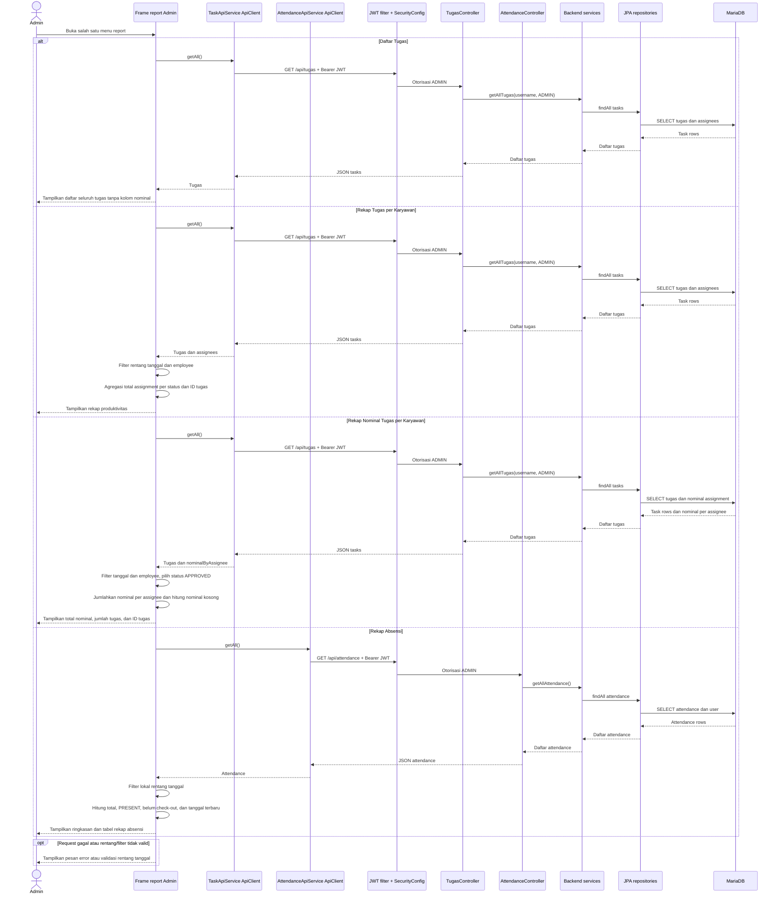

# Admin Reports Sequence

**Tujuan:** Merangkum empat report Admin Desktop dan pemrosesan data di sisi client.

**Interpretasi:** Keempat menu report menggunakan endpoint data umum, bukan endpoint report khusus. Penyaringan dan agregasi dilakukan di Admin Desktop. Rekap produktivitas menghitung status dan jumlah assignment per karyawan; nominal hanya menjumlahkan tugas `APPROVED` dan menampilkan nominal yang belum tersedia. Tidak ada proses export pada alur report yang ditelusuri.
