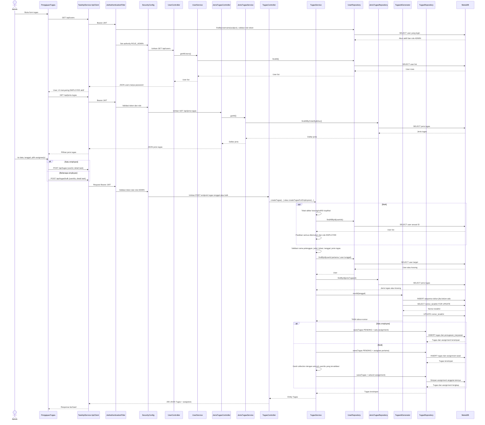

# Task Assignment Sequence

**Tujuan:** Menunjukkan pengambilan pilihan form dan pembuatan task untuk satu atau banyak employee.

**Interpretasi:** Form memilih karyawan melalui multi-selection. Backend memvalidasi duplikasi dan keberadaan ID serta role employee sebelum membuat row task dan assignment dalam transaksi. `TugasIdGenerator` mengunci counter per tahun lewat query native. Source service create memastikan role employee tetapi tidak memvalidasi status ACTIVE; UI form menyaring karyawan aktif.
