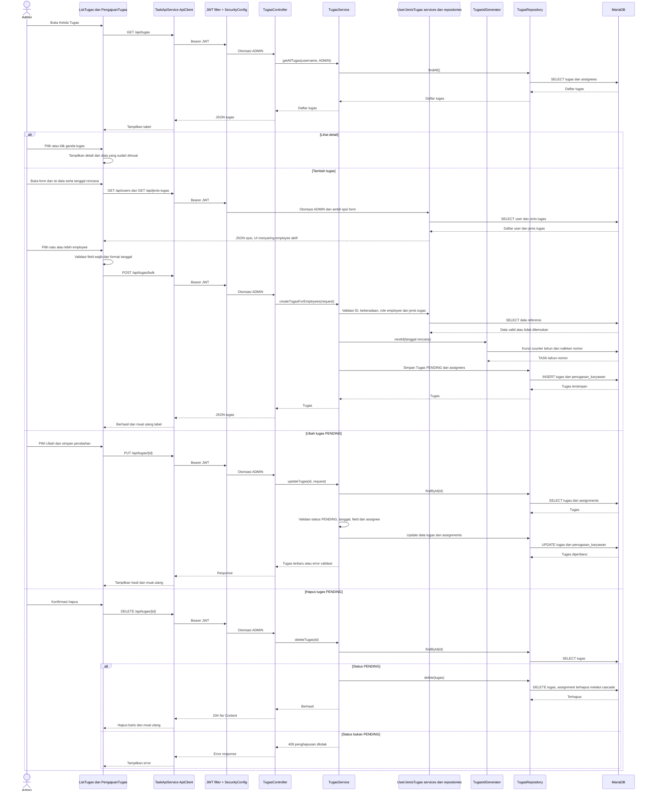

# Admin Task Management Sequence

**Tujuan:** Menjelaskan baca, tambah, ubah, dan hapus tugas dari menu Kelola Tugas Admin Desktop.

**Interpretasi:** Form Admin membuat tugas selalu melalui `POST /api/tugas/bulk`, termasuk jika hanya satu employee dipilih. Form menyaring employee aktif; service create memvalidasi keberadaan dan role employee, tetapi tidak memeriksa status aktif. Edit dan hapus biasa hanya berlaku untuk `PENDING`; penjadwalan ulang tugas `REJECTED` dijelaskan pada [sequence verifikasi](task-verification-sequence.md). Tanggal adalah rencana, bukan deadline atau waktu pembuatan.
