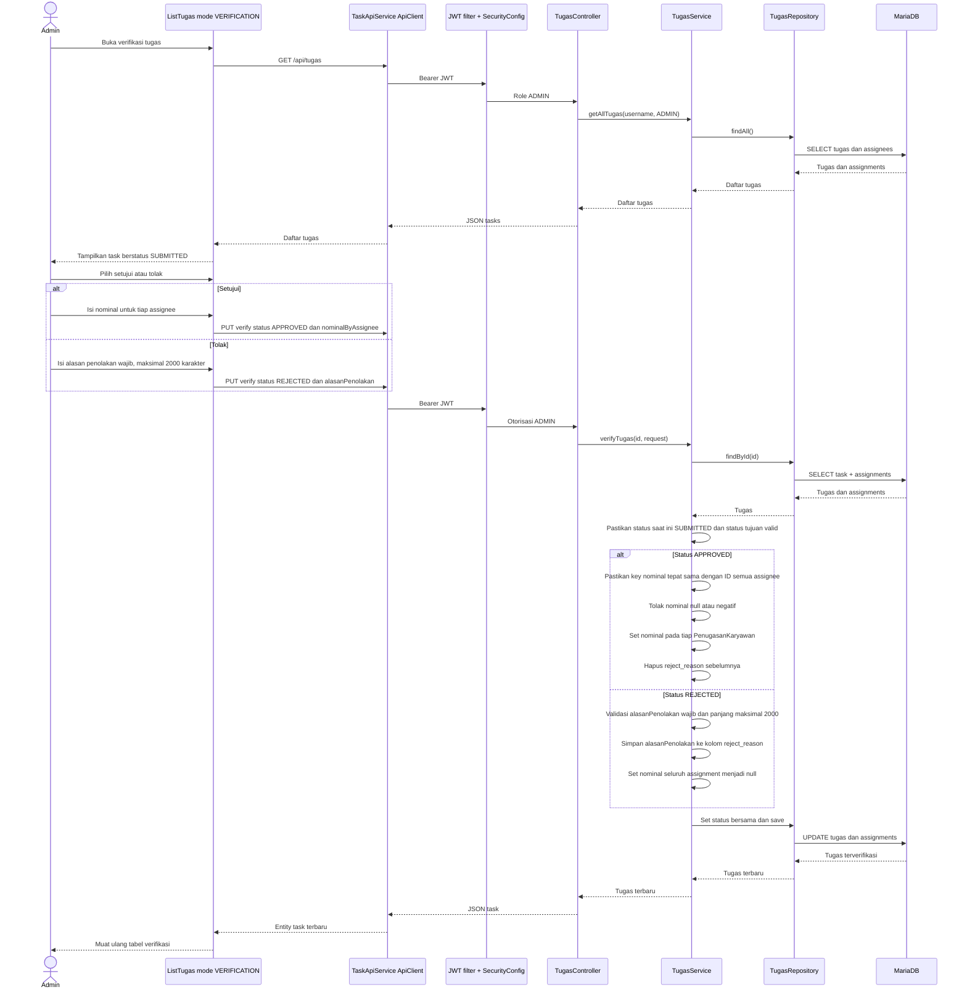
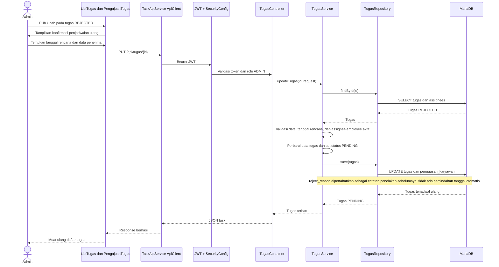

# Task Verification Sequence

**Tujuan:** Menjelaskan verifikasi Admin dan validasi nominal per assignee.

**Interpretasi:** Verifikasi hanya menerima tugas `SUBMITTED`. Nominal harus tersedia untuk setiap anggota dan tidak negatif saat approve; saat reject alasan wajib diisi dan nominal semua assignment di-null-kan. Alasan disimpan ke kolom database `reject_reason` dan dikirim pada JSON sebagai `alasanPenolakan`. Status tugas satu nilai bersama untuk seluruh assignee.

## Penjadwalan ulang tugas yang ditolak

**Interpretasi:** Tugas `REJECTED` hanya kembali ke `PENDING` setelah admin mengedit dan menyimpan data serta tanggal rencana. Backend tidak menjadwalkan ulang secara otomatis. Karyawan dapat melihat alasan penolakan sebelumnya pada detail tugas.
