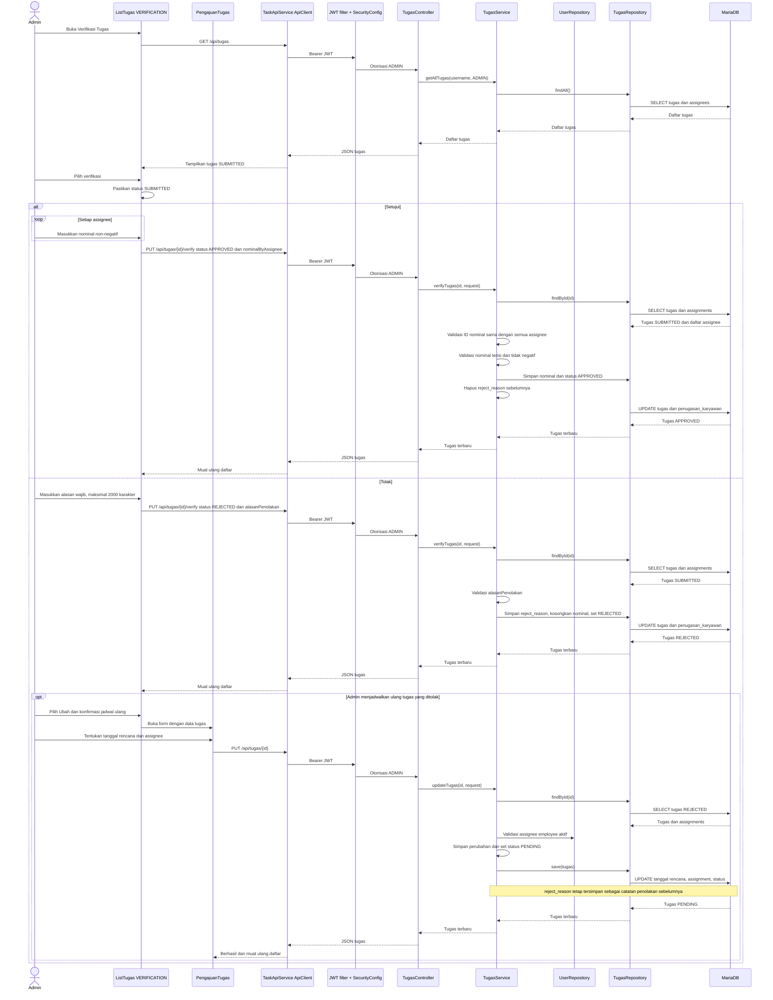

# Admin Task Verification Sequence

**Tujuan:** Menjelaskan persetujuan/penolakan tugas dan penjadwalan ulang manual untuk tugas yang ditolak.

**Interpretasi:** Hanya tugas `SUBMITTED` yang dapat diverifikasi. Persetujuan menyimpan nominal per assignee dan menghapus alasan penolakan lama. Penolakan memerlukan alasan dan mengosongkan nominal. Penjadwalan ulang tidak otomatis: admin mengedit tanggal rencana dan assignee; setelah penyimpanan backend mengubah status `REJECTED` menjadi `PENDING`. Tanggal rencana tidak membatasi pengerjaan lebih awal.
