# Use Case Diagram

**Tujuan:** Menunjukkan fitur yang memiliki route UI/API dan aturan backend aktif. Relasi `include`/`extend` tidak ditambahkan karena source tidak menunjukkan use-case UML terpisah yang dipanggil sebagai kewajiban antar fitur; prasyarat ditulis sebagai catatan.

```mermaid
flowchart LR
    Admin[Admin]
    Employee[Karyawan]

    subgraph System[apkOffice]
        Login((Login))
        ChangePassword((Ubah password sendiri))
        Users((Kelola user karyawan))
        Jabatan((CRUD jabatan dan status))
        Jenis((CRUD jenis tugas))
        AttendanceAll((Lihat seluruh absensi))
        AttendanceMe((Lihat riwayat absensi sendiri))
        CheckIn((Check-in))
        CheckOut((Check-out))
        TaskAssign((Buat dan tugaskan tugas))
        TaskEdit((Ubah tugas PENDING / REJECTED))
        TaskDelete((Hapus tugas PENDING))
        TaskVerify((Verifikasi SUBMITTED dan isi nominal))
        TaskListReport((Lihat daftar tugas))
        AttendanceReport((Lihat rekap absensi))
        ProductivityReport((Lihat rekap produktivitas tugas))
        NominalReport((Lihat rekap nominal tugas))
        StartTask((Mulai tugas))
        SubmitTask((Kirim tugas))
        AssignedTasks((Lihat tugas yang ditugaskan))
    end

    Admin --> Login
    Employee --> Login
    Admin --> ChangePassword
    Employee --> ChangePassword
    Admin --> Users
    Admin --> Jabatan
    Admin --> Jenis
    Admin --> AttendanceAll
    Admin --> TaskAssign
    Admin --> TaskEdit
    Admin --> TaskDelete
    Admin --> TaskVerify
    Admin --> TaskListReport
    Admin --> AttendanceReport
    Admin --> ProductivityReport
    Admin --> NominalReport
    Employee --> AttendanceMe
    Employee --> CheckIn
    Employee --> CheckOut
    Employee --> AssignedTasks
    Employee --> StartTask
    Employee --> SubmitTask
```

### Prasyarat dan batas akses yang diterapkan

- Semua endpoint selain login, health check, dan `/uploads/**` membutuhkan autentikasi menurut security chain. CRUD jabatan/jenis tugas dan pengelolaan user/tugas dibatasi Admin.
- Pengelolaan user menolak role selain `EMPLOYEE`; karyawan harus memiliki jabatan aktif saat dibuat atau saat jabatan diganti.
- Employee hanya mendapat tugas yang terhubung melalui `penugasan_karyawan`. Untuk membaca daftar, ia harus memiliki record attendance hari ini. Mulai/kirim tugas juga memerlukan check-in dan belum check-out.
- Check-out menolak bila tidak ada tugas assigned berstatus `SUBMITTED` atau `APPROVED` di hasil query `findAssignedTo`.
- Tugas hanya bisa diedit ketika `PENDING` atau `REJECTED`, dihapus ketika `PENDING`, dan diverifikasi ketika `SUBMITTED`.
- `Change password` memakai JWT username sebagai identitas; user harus mengirim password lama.
- Route `preview-*` pada Employee Web menampilkan halaman di luar `ProtectedRoute`; halaman ini bukan use case API baru dan backend tetap menerapkan autentikasi.

**Interpretasi:** Aktor berasal dari enum `User.Role` dan pengecekan role di backend/client. Fitur laporan tidak memiliki endpoint report khusus: client menghitung ringkasan dari endpoint absensi/user/tugas.
