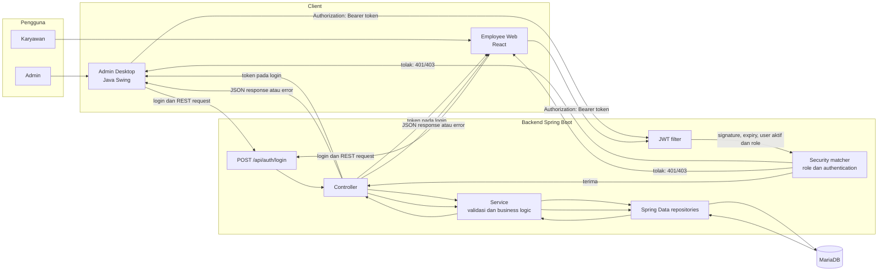
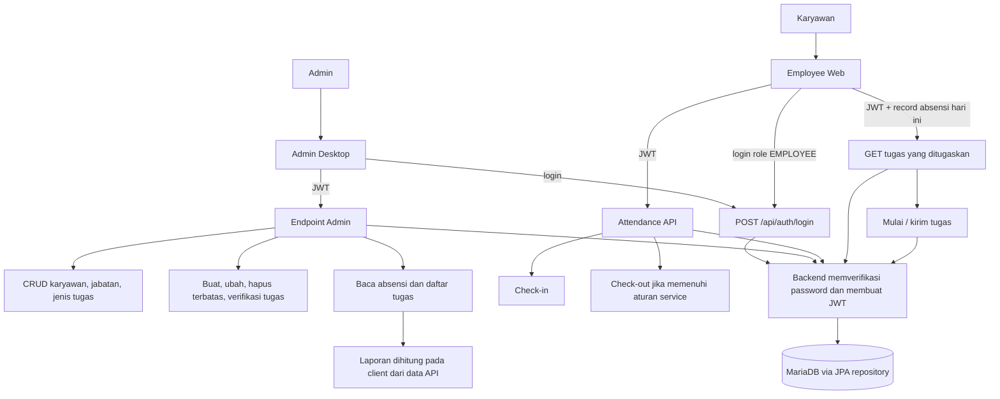

# System Workflow Diagram

**Tujuan:** Merangkum alur Admin dan Employee dari client menuju backend dan database.

**Komponen:** Admin Desktop, Employee Web, JWT/security filter, controller, service, repository, MariaDB. Keduanya memakai endpoint backend yang sama; Admin Desktop mengirim HTTP JSON dengan token dari `AuthSession`, Employee Web menambahkan token `sessionStorage` pada `apiRequest`.

### Alur berdasar role

**Interpretasi:** Login publik menghasilkan token JWT bila kredensial benar dan akun aktif. Pada request terlindungi filter memvalidasi token, lalu role request dibatasi oleh `SecurityConfig` dan beberapa controller/service. Backend menjadi satu-satunya jalur aplikasi menuju data. Dashboard dan report Admin mengambil data API lalu menyusun ringkasan di client.

**Catatan:** `GET /api/tugas` untuk Employee memerlukan record absensi tanggal berjalan, tetapi tetap mengembalikan daftar setelah check-out; endpoint mutasi tugas mensyaratkan absensi aktif dan belum check-out.
